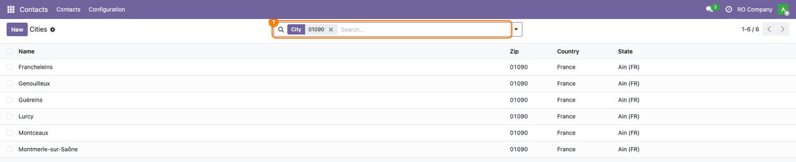
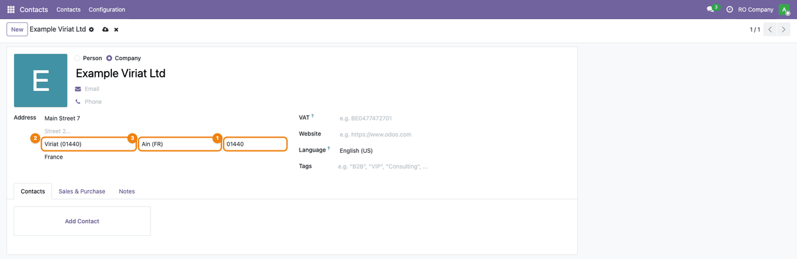
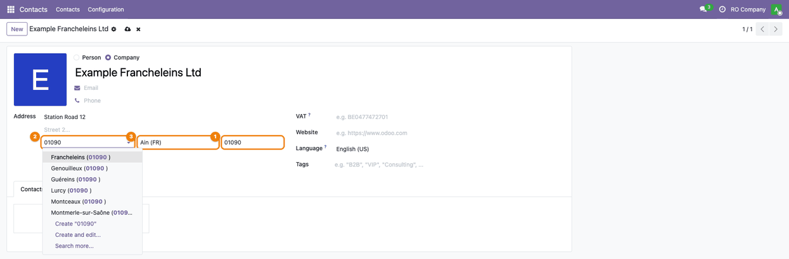
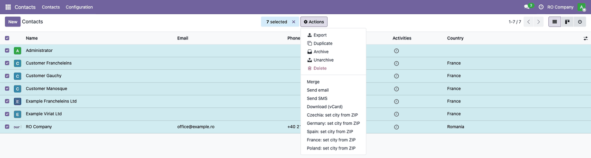
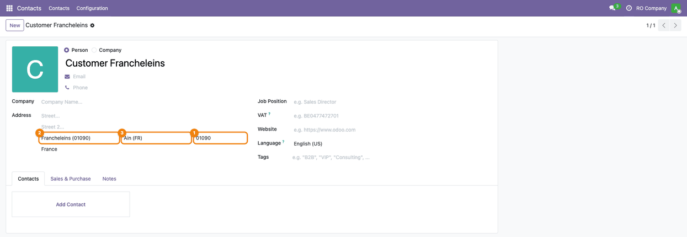

======================
France - City from ZIP
======================

..
   !!!!!!!!!!!!!!!!!!!!!!!!!!!!!!!!!!!!!!!!!!!!!!!!!!!!
   !! This file is generated by oca-gen-addon-readme !!
   !! changes will be overwritten.                   !!
   !!!!!!!!!!!!!!!!!!!!!!!!!!!!!!!!!!!!!!!!!!!!!!!!!!!!
   !! source digest: sha256:421bb8d7e18e5302c5e454866cb86fa706a372d1fe5d8b3e957846cf511d4b44
   !!!!!!!!!!!!!!!!!!!!!!!!!!!!!!!!!!!!!!!!!!!!!!!!!!!!

.. |badge1| image:: https://img.shields.io/badge/maturity-Beta-yellow.png
    :target: https://odoo-community.org/page/development-status
    :alt: Beta
.. |badge2| image:: https://img.shields.io/badge/license-LGPL--3-blue.png
    :target: http://www.gnu.org/licenses/lgpl-3.0-standalone.html
    :alt: License: LGPL-3
.. |badge3| image:: https://img.shields.io/badge/github-dhongu%2Fl10n--france-lightgray.png?logo=github
    :target: https://github.com/dhongu/l10n-france/tree/20.0/l10n_fr_zip
    :alt: dhongu/l10n-france

|badge1| |badge2| |badge3|

Loads the French localities (communes) with their postal code and
region, and fills in the city and the region of French addresses from
the postal code.

- Ships the list of French localities with their postal code, linked to
  the regions of France. The data comes from
  `GeoNames <https://www.geonames.org>`__ (Creative Commons Attribution
  4.0).
- France is set to *enforce cities*: the city of a French address is
  chosen from the list.
- On the contact form, typing the postal code (code postal) of a French
  address sets the city and the region. A postal code shared by several
  localities sets only the region; the city name, when it matches one of
  them (without accents and case), picks the locality.
- The action *France: set city from ZIP* on contacts links the French
  contacts to the city of their postal code and fills in the region.
- At install, the French contacts are linked: directly on a small
  database, by the scheduled action *France: link contacts to the city
  of their ZIP* in batches on a large one (it deactivates itself when
  done).
- Every form that runs the postal code rules of the contact (for example
  the delivery details of an AWB) gets the region filled in, so the
  shipment can be sent to France without looking it up by hand.

**Table of contents**

.. contents::
   :local:

Usage
=====

1. As an administrator, open **Contacts → Configuration → Localization →
   Cities** and search for a postal code: the French localities of that
   postal code are listed with their département.

   |Cities list filtered on the postal code 01090: the localities
   Francheleins, Genouilleux, Guéreins, all of the state Ain (FR)|

2. Open a French contact and type the postal code in the address: the
   city and the region are filled in.

   |Contact in France: the postal code 01440 fills in the city Viriat
   and the state Ain (FR)|

3. When the postal code is shared by several localities, only the region
   is filled in; choose the city from the list (type the postal code or
   the name in the city field).

   |Contact in France: the postal code 01090 fills in the state Ain
   (FR); the city field lists the localities of 01090|

4. To complete existing or imported contacts, select them in the list
   and run *Actions → France: set city from ZIP*.

   |Contacts list with French contacts selected and the Actions menu
   open on France: set city from ZIP|

   |Contact Customer Francheleins after the action: ZIP 01090, city
   Francheleins (01090) and state Ain (FR)|

Changelog
=========

20.0.1.0.0 (2026-11-16)
-----------------------

**Changed**

- Migration to Odoo 20: the PostgreSQL codes to retry are defined in the
  module (``odoo.service.model.PG_CONCURRENCY_ERRORS_TO_RETRY`` was
  removed) and the relink position uses ``ir.config_parameter``
  ``get_int`` / ``set_int``.

19.0.1.0.0 (2026-11-16)
-----------------------

**Added**

- French localities with postal code and region, from GeoNames.
- City and region filled in from the postal code on French addresses;
  action and scheduled action to link the existing contacts.
- Consultant sheet (readme/FISA_CONSULTANT.md) and screenshots, in
  English.

Bug Tracker
===========

Bugs are tracked on `Terrabit Issues <https://www.terrabit.ro/helpdesk>`_.
In case of trouble, please check there if your issue has already been reported.

Do not contact contributors directly about support or help with technical issues.

Credits
=======

Authors
-------

* Terrabit

Maintainers
-----------

.. |maintainer-dhongu| image:: https://github.com/dhongu.png?size=40px
    :target: https://github.com/dhongu
    :alt: dhongu

Current maintainer:

|maintainer-dhongu| 

This module is part of the `dhongu/l10n-france <https://github.com/dhongu/l10n-france/tree/20.0/l10n_fr_zip>`_ project on GitHub.

You are welcome to contribute.